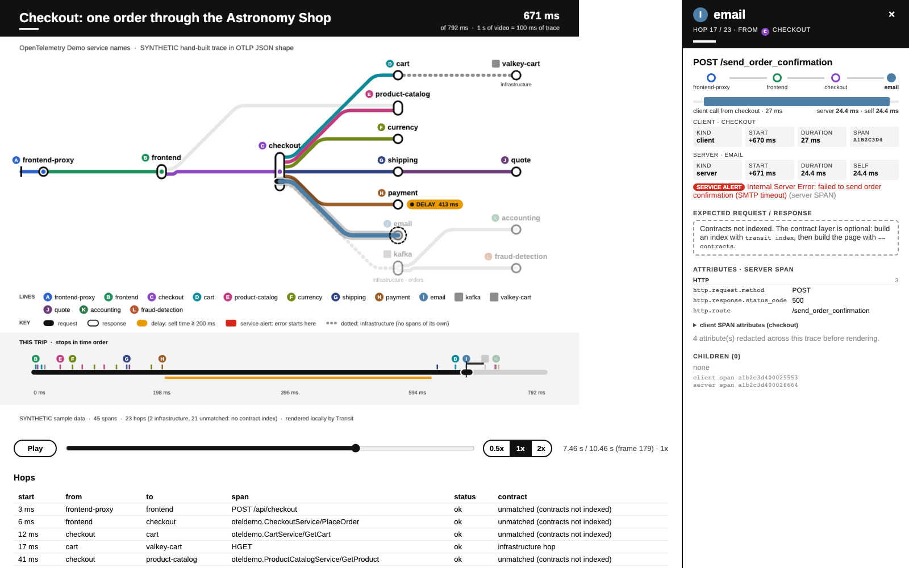

<p align="center">
  
</p>

<h1>🚇 Transit</h1>

<p align="center"><b>Subway maps of your data.</b></p>

Transit is a local toolkit of Agent Skills that turns requests, CI runs, and coding-agent sessions into animated transit maps. Lines show the main unit of work, stations show individual events, DELAY marks slow work, and SERVICE ALERT marks an error or other failure.

## Example prompts

Type these in Claude Code, Codex or Cursor once the skills are installed.

**request-transit**
- "Animate this OTLP trace as a transit map: `./trace.json`"
- "Draw Datadog trace 4bf92f… as a transit map and tell me where the delay is"
- "Make a GIF of trace abc123 from Tempo for the incident doc"

**ci-transit**
- "Show my last failed GitHub Actions run as a transit map"
- "Render run 1234567890 in owner/repo as an MP4"

**agent-transit**
- "Make an MP4 of my last Claude Code session"
- "Draw my latest Codex session as a transit map. Which tool calls were slow?"

## Skills

### request-transit

**A public transit map for your requests.** ([skill README](https://github.com/israelvicars/transit/blob/main/skills/request-transit/README.md))

The animation at the top of this page shows request-transit.

Services are lines, spans are stations, and slow or failed calls are DELAY or SERVICE ALERT markers. It accepts OpenTelemetry/OTLP, Datadog, PostHog, AWS X-Ray, and Grafana Tempo data. Example commands are `npm run build`, `npm run render`, and `npm run verify`.

Its condensed source guide:

| Source | Input and fetch path |
| --- | --- |
| OpenTelemetry (OTLP JSON) | Local file or exporter/collector output |
| Datadog | MCP result or the local `fetch.mjs datadog-api` command |
| PostHog Distributed Tracing | MCP result or the local `fetch.mjs posthog-api` command |
| AWS X-Ray | AWS CLI `fetch.mjs xray` or an AWS MCP result |
| Grafana Tempo | `fetch.mjs tempo` or a Grafana/Tempo MCP result |

The optional contracts layer reads local service code only after you ask for it, indexes expected request and response shapes, and shows its evidence in the panel. Use `node skills/request-transit/scripts/transit.mjs index`, then build with `--contracts`. Useful flags include `--slow-ms`, `--ms-per-sec`, `--target-seconds`, `--trace-id`, `--redact`, and `--no-download`.

### ci-transit

**A transit map for your CI runs.** (GitHub Actions) ([skill README](https://github.com/israelvicars/transit/blob/main/skills/ci-transit/README.md))


Jobs are lines, steps are stations, and failed, cancelled, or slow steps become SERVICE ALERT or DELAY markers. It reads a saved GitHub Actions run or fetches one read-only through the local `gh` CLI. Example commands are `npm run build:ci`, `npm run render:ci`, and `npm run verify:ci`.

### agent-transit

**A transit map for your coding-agent sessions.** (Claude Code, Codex, Cursor) ([skill README](https://github.com/israelvicars/transit/blob/main/skills/agent-transit/README.md))


Tool families are lines, tool calls are stations, and errors, denials, or long calls become SERVICE ALERT or DELAY markers. By default it keeps only tool names, timing, status, target basenames, and the agent source; prompts, code, commands, output, and arguments stay out of the map. Example commands are `npm run build:agent`, `npm run render:agent`, and `npm run verify:agent`.

## Outputs

| Output | What you get | Ask for it |
| --- | --- | --- |
| Interactive page | One self-contained HTML file. Works offline and makes no network requests. Play, scrub, click a station for details, scroll the list. | "…as a transit map" (default) |
| GIF | A looping animation for docs, PRs and chat | "…as a GIF" |
| MP4 | Deterministic and frame-exact: the same input gives byte-identical video every time | "…as an MP4" or "render a video" |

GIF and MP4 also write a `contact.png` contact sheet. Video needs a local Chromium and ffmpeg; first-run setup reuses what you have and tells you before it downloads anything.

### Side panel



Click a station, train or line in the interactive page, or pause and press `N`, to open the side panel for that hop. It shows the stops the request took to get there, the client and server timing (start, duration and self time), the error message under a SERVICE ALERT when the hop failed, the span's attributes grouped by type, and its child spans. Sensitive-looking attribute keys are redacted when the page is built. If you built with `--contracts`, the panel also shows the expected request and response shapes. The panel is part of the interactive page: it runs locally and makes no network requests.

## Install

Install all three skills for Claude Code, Codex, and Cursor:

```sh
npx skills add israelvicars/transit -g -a claude-code -a codex -a cursor
```

Install one skill with `--skill <name>`; the flag can be repeated:

```sh
npx skills add israelvicars/transit --skill request-transit
```

For Claude Code, add the marketplace and install the suite plugin:

```sh
claude plugin marketplace add israelvicars/transit
claude plugin install transit@transit
```

For Codex, use `$skill-installer install https://github.com/israelvicars/transit/tree/main/skills/<name>` (replace `<name>` with the skill to install). Cursor uses the `npx skills` command above.

## Privacy

Transit is local only: no telemetry, no tracking, no analytics, and no network requests from a built page. Request data and traces stay on your machine. `agent-transit` keeps only tool names and timing by default, with additional metadata limited to what the skill documents.

## Development

```sh
npm test             # all unit, adapter, privacy, and self-contained-copy tests
npm run check        # npm test, every verifier, and the UI/network gates
```

Source lives in `src/<name>/`; the committed, generated `skills/<name>/`
folders are the self-contained install surface for plugins, `npx skills`, and
local symlinks. Run `node scripts/build-skills.mjs` after changing source.

Rendering uses local browser and ffmpeg prerequisites. The optional fetch commands use credentials already configured for your own backend or GitHub account.

MIT

Not affiliated with or endorsed by the MTA.
